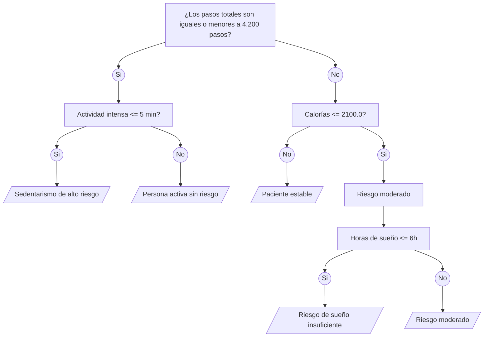

# Avance 2: Primer Artefacto

## Árbol de Decisiones

### Discusión de las Reglas

#### ¿Estas reglas les sirven para un entorno real?
Sí, pueden ser altamente interpretables para cualquier médico o analista, ya que son fáciles y rápidas en calcular y permiten también automatizar alertas tempranas de forma directa.
Aunque el modelo actual está basado en umbrales estáticos y simples, y esto puede generar falsos positivos o simplemente ignorar la variabilidad individual de cada paciente.

#### ¿Qué variable falta?
* **Frecuencia cardiaca en reposo:** Indicador crítico de estrés cardiovascular y recuperación física.
* **Edad y antecedentes médicos del paciente:** El nivel de tolerancia al sedentarismo varía drásticamente según la edad o patologías previas.
* **Nivel de estrés:** Vital para cruzarlo con la eficiencia del sueño y detectar fatiga real.
* **Historial de medicación:** En la parte de fármacos que influyan directamente en el ritmo cardiaco o en los patrones de sueño.
